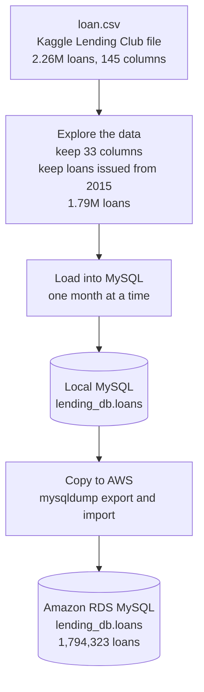

# 00 Source setup: the loan data in MySQL

This stage prepares the source system for the pipeline. The Kaggle Lending Club file is
explored, loaded into MySQL month by month, and then moved to Amazon RDS MySQL. The
pipeline reads its data from RDS, the way a real pipeline reads from a company's
live database.

**Dataset:** [Lending Club Loan Data (CSV) on Kaggle](https://www.kaggle.com/datasets/adarshsng/lending-club-loan-data-csv)

## Flow

## Steps

1. **Explore the data**
   Kept the 33 columns needed for the analysis and only loans issued from January 2015
   onwards. Issue dates are stored per month (for example `Jan-2015`), so the data is
   handled one month at a time.

2. **Load into MySQL**
   Loaded the loans into MySQL one month at a time, oldest month first, so the database
   fills up the way data would arrive over time. The load remembers the last month loaded,
   so it can continue from where it stopped and never loads a month twice.

3. **Move to Amazon RDS**
   Copied the table to RDS MySQL with `mysqldump`. RDS is reachable only from my laptop
   and from Glue (security group rules).

4. **Prepare a test month**
   Held back December 2018 in a side table, so the extract job could be tested with
   "no new data" first and then "new data arriving" (`rds_setup.sql`).

## Result

| Check | Value |
|---|---|
| Loans in `loan.csv` (all years) | 2,260,668 |
| Loans from 2015 onwards | 1,794,323 |
| Months | 48 (2015-01 to 2018-12) |
| Rows in RDS `lending_db.loans` | 1,794,323 (matches the file) |

## Files

| File | Purpose |
|---|---|
| `load_monthly_to_mysql.py` | Loads the loans into MySQL one month at a time |
| `rds_setup.sql` | Copy check, hold back and release December 2018 |

`loan.csv` (about 1.2 GB) is not stored in this repository. Download it from
[Kaggle](https://www.kaggle.com/datasets/adarshsng/lending-club-loan-data-csv).
The `.env` file with passwords is not stored here either.