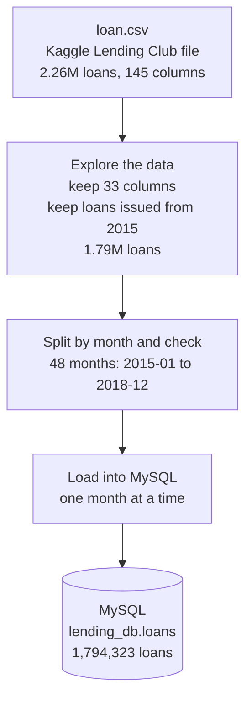

# 00 Source setup: loading the loan data into MySQL

This stage prepares the source system for the pipeline. The Kaggle Lending Club file is
explored, checked month by month, and loaded into a MySQL database. The pipeline then
reads its data from MySQL, the way a real pipeline reads from a company's live database.

**Dataset:** [Lending Club Loan Data (CSV) on Kaggle](https://www.kaggle.com/datasets/adarshsng/lending-club-loan-data-csv)

## Flow

## Steps

1. **Explore the data**
   Kept the 33 columns needed for the analysis and only loans issued from January 2015
   onwards. Issue dates are stored per month (for example `Jan-2015`), so the data is
   handled one month at a time.

2. **Split by month and check**
   Split the loans into one file per month (`loans_2015-01.csv`, `loans_2015-02.csv` and so on)
   to check the monthly split worked and every month had data.

3. **Load into MySQL**
   Loaded the loans into MySQL one month at a time, oldest month first, so the database
   fills up the way data would arrive over time. The load reads `loan.csv` directly and
   remembers the last month loaded, so it can continue from where it stopped and never
   loads a month twice.

## Result

| Check | Value |
|---|---|
| Loans in `loan.csv` (all years) | 2,260,668 |
| Loans from 2015 onwards | 1,794,323 |
| Months | 48 (2015-01 to 2018-12) |
| Rows in MySQL `lending_db.loans` | 1,794,323 (matches the file) |

## Files

| File | Purpose |
|---|---|
| `data_monthly_split.py` | Splits the loans into monthly files for checking |
| `load_monthly_to_mysql.py` | Loads the loans into MySQL one month at a time |

`loan.csv` (about 1.2 GB) is not stored in this repository. Download it from
[Kaggle](https://www.kaggle.com/datasets/adarshsng/lending-club-loan-data-csv).
The `.env` file with passwords is not stored here either.
