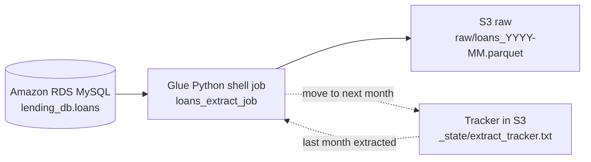

# 01 Ingestion: from the source database to S3 raw

This stage moves the loans from the source database into the raw (Bronze) layer in S3.
A Glue job runs inside AWS, finds the next month that has not been extracted yet,
reads it from RDS MySQL and saves it in S3 as a Parquet file.

## Flow

## Steps

1. **Private route for Glue**
   - Security group `lending-mysql-sg`: port 3306 from my laptop only, plus a
     self-referencing rule so Glue can reach RDS.
   - S3 gateway endpoint, so Glue can reach S3 from inside the VPC (free).
   - Glue JDBC connection `lending-rds-conn` with the VPC, subnet and security group.

2. **Extract job**
   `loans_extract_job.py` reads the tracker, works out the next month, queries
   RDS for it, writes Parquet to raw, and moves the tracker forward only after the
   write succeeds. If the month has no rows yet, it writes nothing.

3. **Test new data arriving**
   December 2018 was held back in RDS, the job was run, then the month was released
   and the job was run again (see `00_source_setup/rds_setup.sql`).

## Test results

| Run | Situation | Result |
|---|---|---|
| 1 | December 2018 not in RDS yet | No rows, nothing written, tracker stayed at 2018-11 |
| 2 | December 2018 added to RDS | 40,134 rows written to `raw/loans_2018-12.parquet`, tracker moved to 2018-12 |

## Glue job settings

| Setting | Value |
|---|---|
| Type | Python shell, Python 3.9, analytics libraries |
| Capacity | 1/16 DPU, 10 minute timeout |
| Connection | `lending-rds-conn` |
| Job parameters | `--db_host`, `--db_name`, `--db_user`, `--db_password` |

The password is only stored in the Glue job parameters, not in this repository.
In production it would live in AWS Secrets Manager.

## Problems solved

| Problem | Cause | Fix |
|---|---|---|
| Glue connection failed: VPC has no access to STS | Newer connection type checks itself from inside the VPC | Used a plain JDBC connection instead |
| Test connection: no S3 endpoint for subnet | Subnet used the main route table implicitly | Linked the subnet to the route table explicitly |
| Job failed with exit code 2 | `--db_password` parameter missing | Added the job parameter |
| Job failed with NoSuchKey | Tracker file not in S3 yet | Uploaded `_state/extract_tracker.txt` |

## Files

| File | Purpose |
|---|---|
| `loans_extract_job.py` | Glue job: next month from RDS to S3 raw |

## Cost notess

- RDS (db.t4g.micro) is stopped or deleted when not in use, with a snapshot to restore from.
- The S3 gateway endpoint is free. Interface endpoints (STS, Secrets Manager) were
  avoided because they charge per hour.