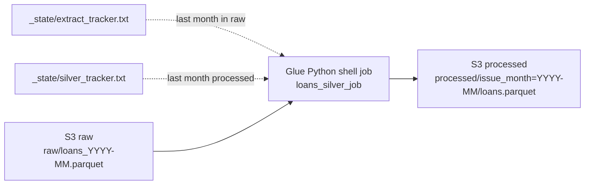

# 02 Transformation: from S3 raw to S3 processed (Silver)

This stage cleans each new month of raw loans and saves it in S3 as typed Parquet,
one folder per issue month.

## Flow

## What the job does

1. Renames columns to readable names (for example `loan_amnt` to `loan_amount`).
2. Converts dates (`Jan-2015`) and numbers (removes `%` signs).
3. Standardises text casing, employment length and home ownership.
4. Replaces placeholder values (debt-to-income `-1` and `999`) with blanks.
5. Adds `issue_month`, `loan_status_category`, `is_bad`, data quality flags and a `loan_key`.
6. Checks 7 rules (row counts, dates, grades, terms, unique keys) and stops if one fails.

The job finds its own work: it processes every month between the two trackers,
so a missed run is caught up automatically.

## How it evolved

| Version | Input | Started by | Status |
|---|---|---|---|
| 1 | One raw CSV file | S3 upload event, Lambda `trigger_loans_silver` | Retired |
| 2 | Raw Parquet, months found from the trackers | Manual for now, Glue Workflow next | Current |

The 48 months of history were first processed locally with the same functions
(1,794,323 rows) and loaded into Redshift `silver.loans`.

## Test result

| Situation | Result |
|---|---|
| December 2018 in raw, Silver tracker at 2018-11 | 40,134 rows processed, all checks passed, tracker moved to 2018-12 |

## Files

| File | Purpose |
|---|---|
| `loans_silver_job.py` | Glue job: raw Parquet to Silver Parquet (version 2) |
| `lambda_trigger_loans_silver.py` | Version 1 trigger, kept as a record |
