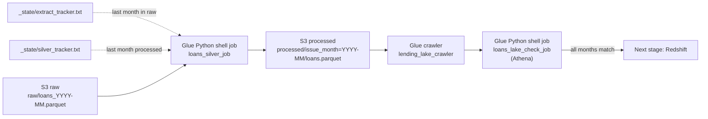

# 02 Transformation: from S3 raw to S3 processed (Silver)

This stage cleans each new month of raw loans, saves it in S3 as typed Parquet
(one folder per issue month), and then checks in Athena that every month in raw
arrived in processed before anything is loaded into the warehouse.

## Flow

## What the Silver job does

1. Renames columns to readable names (for example `loan_amnt` to `loan_amount`).
2. Converts dates (`Jan-2015`) and numbers (removes `%` signs).
3. Standardises text casing, employment length and home ownership.
4. Replaces placeholder values (debt-to-income `-1` and `999`) with blanks.
5. Adds `issue_month`, `issue_year`, `loan_status_category`, `is_bad`, data quality flags and a `loan_key`.
6. Checks 7 rules (row counts, dates, grades, terms, unique keys) and stops if one fails.

The job finds its own work: it processes every month between the two trackers,
so a missed run is caught up automatically.

## Data lake check (Athena)

After Silver, the crawler registers the new month as a partition, and
`loans_lake_check_job` runs one Athena query that compares the number of loans
per month in raw and in processed. The query returns only months that do not match:

- no rows: the job succeeds and the pipeline continues to Redshift
- any rows: the job fails, lists the months, and nothing is loaded into the warehouse

The Silver job checks the one month it just wrote. The Athena check looks at
every month from the outside, so it also catches a month that was never processed
or a partition the crawler did not register.

The Athena tables (`raw`, `processed`) are created by the Glue crawler in the
`lending_lake` database. All lake queries are in `sql/athena/checks.sql`.

## Test results

| Situation | Result |
|---|---|
| December 2018 in raw, Silver tracker at 2018-11 | 40,134 rows processed, all checks passed, tracker moved to 2018-12 |
| Athena check after Silver | All 48 months match between raw and processed (1,794,323 loans) |

## Problems solved

| Problem | Cause | Fix |
|---|---|---|
| Crawler table could not be queried: duplicate columns | `issue_month` is both a column in the files and the partition folder name | Removed the duplicate column from the catalog schema and set the crawler to keep it |
| Redshift COPY failed with a Spectrum Scan Error for December | The backfill (pandas 2) wrote `issue_year` as int32, the Glue job (pandas 1) as int64 | Set the type explicitly in the Silver job: `.astype("int32")` |

## Files

| File | Purpose |
|---|---|
| `loans_silver_job.py` | Glue job: raw Parquet to Silver Parquet |
| `loans_lake_check_job.py` | Glue job: Athena check that every month matches between raw and processed |